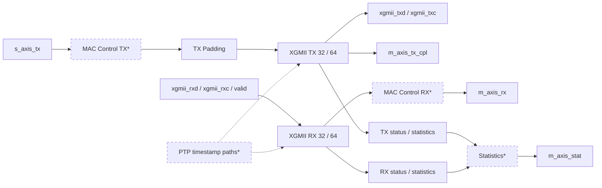

# DUT TAXI_ETH_MAC_10G

# Objetivo

Documentar la arquitectura funcional de `taxi_eth_mac_10g` como base para el futuro desarrollo de su entorno de verificación.

El DUT recibe y transmite paquetes mediante AXI-Stream y los convierte entre el flujo de paquetes del MAC y una interfaz XGMII de 32 o 64 bits. Este documento describe el diseño existente; no constituye un Test Plan ni afirma cumplimiento exhaustivo del estándar.

---

# Estándar Aplicable

## IEEE 802.3

Áreas del estándar relacionadas con las funciones implementadas:

### Clause 3 — MAC Frame

Relevante para el formato de trama, preámbulo/SFD, longitud, padding y FCS. La aplicabilidad exacta de cada comportamiento depende de la configuración del DUT y del perfil Ethernet que se integre.

### Clause 4 — MAC Control

Relevante cuando se habilita el procesamiento de tramas MAC Control, incluyendo su identificación, generación y política de forwarding.

### Annex 31B — PAUSE / Link-Level Flow Control

El RTL documenta explícitamente el soporte LFC/PAUSE en esta cláusula. La función depende de la habilitación de MAC Control y de su configuración.

### Annex 31D — Priority Flow Control

El RTL documenta explícitamente el soporte PFC. La función depende de `PFC_EN` y de la configuración de prioridades, quanta y acknowledgements. PFC también se relaciona con IEEE 802.1Qbb; la implementación no constituye por sí sola una declaración de conformidad integral con ese estándar.

### Clause 46 — Reconciliation Sublayer y XGMII

Relevante para la interfaz XGMII entre el MAC y el bloque PHY/RS. Este DUT implementa el lado MAC/XGMII; no implementa el PCS ni una interfaz serial SERDES.

La nomenclatura 31B/31D como anexos sigue los comentarios del RTL. Las referencias deben confirmarse contra la edición del estándar adoptada por el proyecto antes de establecer trazabilidad normativa detallada; numeración, texto y aplicabilidad pueden variar entre ediciones. La relación con Clause 90 para timestamping PTP es solo una referencia condicional y no implica conformidad completa con PTP.

---

# Función General del DUT

`taxi_eth_mac_10g` implementa un MAC Ethernet parametrizable que:

- Transmite paquetes AXI-Stream mediante XGMII.
- Recibe tramas desde XGMII y las presenta como paquetes AXI-Stream.
- Genera y comprueba FCS.
- Aplica padding TX y verifica límites de longitud.
- Reporta estado de paquetes y errores.
- Puede habilitar funciones opcionales de PTP, estadísticas, LFC y PFC.

El ancho por defecto es 64 bits. PTP timestamping/distribución, estadísticas y MAC Control están deshabilitados por defecto; el padding TX está habilitado. `PTP_TS_EN` habilita los campos de timestamp en la interfaz RX y el timestamp de completion TX. La distribución mediante `taxi_ptp_td_leaf` solo se instancia cuando `PTP_TS_EN && PTP_TD_EN`; en cualquier otra combinación, `tx_ptp_ts_out`/`rx_ptp_ts_out` son passthrough de sus entradas, los indicadores `*_step_out` y `*_locked` valen cero, y la presencia de timestamp en los metadatos de paquete/completion sigue dependiendo de `PTP_TS_EN`.

El Test Plan, Coverage Matrix, IEEE Traceability Matrix y Verification Status se mantienen en [`docs/TEST_PLAN_MAC_10G.xlsx`](./docs/TEST_PLAN_MAC_10G.xlsx).

---

# DUT Overview

## Top Module

El módulo top es `taxi_eth_mac_10g`, definido en `src/eth/rtl/taxi_eth_mac_10g.sv`.

El parámetro `DATA_W` selecciona la implementación XGMII de 32 o 64 bits. Para cualquier instancia solo se genera una de las dos variantes.

## Clocks y Resets

| Dominio | Clock | Reset | Uso |
|---|---|---|---|
| TX | `tx_clk` | `tx_rst` | Padding, TX XGMII, MAC Control TX |
| RX | `rx_clk` | `rx_rst` | RX XGMII, MAC Control RX |
| PTP | `ptp_clk`, `ptp_sample_clk` | `ptp_rst` y resets locales | Distribución de tiempo PTP opcional |
| Estadísticas | `stat_clk` | `stat_rst` | Salida de estadísticas opcional |

Los resets se muestrean sincrónicamente y son activos en alto en los bloques correspondientes. El DUT no genera clocks; las relaciones entre dominios y la secuencia de reset deben ser definidas por la integración.

## Interfaces Principales

### TX AXI-Stream

- `s_axis_tx`: entrada de paquetes al MAC.
- `m_axis_tx_cpl`: salida de completions; retorna el tag/ID y puede incluir timestamp cuando PTP está habilitado.

### RX AXI-Stream

- `m_axis_rx`: salida de paquetes recibidos.
- `tuser[0]` se utiliza como indicador de error; con PTP habilitado también se transporta timestamp.

### XGMII

- RX: `xgmii_rxd`, `xgmii_rxc` y `xgmii_rx_valid`.
- TX: `xgmii_txd`, `xgmii_txc` y `xgmii_tx_valid`.
- `DATA_W` admite 32 o 64 bits; `CTRL_W` debe tener granularidad de un byte.

### Interfaces opcionales

- **Gearbox (opcional):** `TX_GBX_IF_EN` habilita el control TX por `tx_gbx_req_sync`/`tx_gbx_req_stall` y la salida `tx_gbx_sync`; `GBX_CNT` determina el ancho de las señales de sincronización TX. `RX_GBX_IF_EN` habilita el uso de `xgmii_rx_valid` para pausar el avance RX. No hay un conjunto separado de señales de solicitud/acknowledgement de gearbox RX.
- **PTP:** timestamps TX/RX, entradas de tiempo, step/lock y clocks de distribución.
- **Flow control:** solicitudes y acknowledgements LFC/PFC y pausa.
- **Estadísticas:** `m_axis_stat` y salidas de eventos/status de TX y RX.

---

# Estructura de Archivos y Jerarquía

```text
taxi_eth_mac_10g
    │
    ├─ taxi_axis_pad                         TX padding / underflow drop
    │
    ├─ PTP timestamp metadata*                 habilitado con PTP_TS_EN
    ├─ PTP time-distribution leaves*           habilitados con PTP_TS_EN y PTP_TD_EN
    │   ├─ taxi_ptp_td_leaf (TX)
    │   └─ taxi_ptp_td_leaf (RX)
    │
    ├─ Datapath XGMII                         una rama según DATA_W
    │   ├─ DATA_W = 64
    │   │   ├─ taxi_axis_xgmii_tx_64
    │   │   │   └─ taxi_lfsr                 FCS TX
    │   │   └─ taxi_axis_xgmii_rx_64
    │   │       └─ taxi_lfsr                 FCS RX
    │   └─ DATA_W = 32
    │       ├─ taxi_axis_xgmii_tx_32
    │       │   └─ taxi_lfsr                 FCS TX
    │       └─ taxi_axis_xgmii_rx_32
    │           └─ taxi_lfsr                 FCS RX
    │
    ├─ MAC Control*                           habilitado con PAUSE_EN o PFC_EN
    │   ├─ taxi_mac_ctrl_tx
    │   ├─ taxi_mac_ctrl_rx
    │   ├─ taxi_mac_pause_ctrl_tx
    │   ├─ taxi_mac_pause_ctrl_rx
    │   └─ taxi_sync_signal                  cruce de señales entre TX/RX
    │
    ├─ Estadísticas*                          habilitado con STAT_EN
    │   └─ taxi_eth_mac_stats
    │       ├─ taxi_stats_collect (TX/RX)
    │       ├─ taxi_axis_async_fifo (TX/RX)
    │       └─ taxi_axis_arb_mux
    │
    └─ Alternativas cuando las funciones están deshabilitadas
        ├─ taxi_axis_null_src                sin estadísticas
        └─ taxi_axis_tie                     sin MAC Control
```

`taxi_lfsr`, `taxi_axis_pad`, `taxi_ptp_td_leaf`, sincronizadores y módulos de estadísticas son dependencias RTL; las interfaces AXI-Stream no son submódulos.

---

# Block Diagram



`*` Función opcional controlada por parámetros.

---

# Arquitectura Principal

## TX Datapath

1. `s_axis_tx` entrega el paquete al camino TX.
2. Si MAC Control está habilitado, `taxi_mac_ctrl_tx` puede insertar tramas de control; de lo contrario, se usa la ruta de bypass.
3. `taxi_axis_pad` agrega padding hasta la longitud mínima configurada y permite descartar tramas con underflow.
4. El adaptador TX de 32 o 64 bits genera preámbulo/SFD, transmite el payload, calcula y añade FCS, maneja longitud máxima e inserta IFG.
5. Se generan señales de estado, `xgmii_tx_valid` y completions; PTP puede agregar timestamps.

## RX Datapath

1. El adaptador RX de 32 o 64 bits recibe XGMII y reconoce inicio, preámbulo/SFD y terminación.
2. Convierte la trama a AXI-Stream, valida FCS y longitud, y reporta errores de framing/preambulo y clasificación.
3. Si MAC Control está habilitado, `taxi_mac_ctrl_rx` identifica tramas de control y las procesa o reenvía según configuración.
4. `m_axis_rx` entrega el paquete y su información de estado; PTP puede incluir timestamp.

La salida RX no ofrece soporte de backpressure: los adaptadores XGMII RX no consumen `m_axis_rx.tready`, y la instancia superior de `taxi_mac_ctrl_rx` usa `USE_READY=0`. El consumidor debe aceptar los beats cuando se presenten; no se debe asumir retención de datos ante `tready=0`.

## FSMs Relevantes

### TX XGMII

Las FSMs del adaptador TX controlan los estados de idle, payload, FCS/error e IFG. La implementación de 32 bits utiliza estados adicionales para preámbulo y segmentación del FCS.

### RX XGMII

Las FSMs RX coordinan idle, preámbulo (según ancho), payload y último segmento/terminación, incluyendo extracción del FCS y validación del cierre.

### MAC Control y Pausa

- TX selecciona tráfico de datos o tramas MAC Control.
- RX analiza y valida campos configurables de las tramas de control.
- Los controladores LFC/PFC gestionan solicitudes, acknowledgements, quanta y refresco.
- Algunas señales LFC/pausa se sincronizan entre los dominios TX y RX.

---

# Funcionalidades Implementadas

- Conversión entre AXI-Stream de paquetes y XGMII de 32/64 bits.
- Generación y detección de preámbulo/SFD.
- Generación y comprobación de FCS.
- Padding TX, límites de longitud e IFG/DIC.
- Indicadores de trama buena/mala, errores y clasificación unicast/multicast/broadcast/VLAN.
- Completions TX con tag/ID.
- Timestamping y distribución PTP opcionales.
- Generación/procesamiento de MAC Control opcionales.
- Link-Level Flow Control (LFC/PAUSE) y Priority Flow Control (PFC) opcionales.
- Recolección y emisión de estadísticas opcionales.
- Interfaces opcionales de coordinación con gearbox.

La detección/clasificación VLAN reportada por estado no implica inserción o eliminación general de etiquetas VLAN.

---

# Riesgos de Verificación

## Críticos

### Límites de trama y FCS

Verificar longitudes mínima/máxima, padding, FCS correcto/incorrecto, tramas truncadas y errores de usuario/underflow. Confirmar la convención de longitud usada por los valores por defecto `60-1` y `1518-1`.

### Variantes de ancho y alineación

Las rutas de 32 y 64 bits tienen implementaciones separadas y control de terminación diferente. Revisar la colocación del último byte, `tkeep`, preámbulo y FCS en cada ancho.

### Backpressure RX

El RTL no usa `m_axis_rx.tready` para frenar la salida; el soporte de backpressure RX no está implementado. El consumidor debe permanecer preparado para aceptar la salida.

## Importantes

### Ramas opcionales

PTP, MAC Control y estadísticas están deshabilitados en la configuración por defecto. El camino por defecto no valida estas funcionalidades.

### CDC, clocks y resets

Las rutas TX/RX, PTP y estadísticas pueden operar en dominios distintos. Comprobar reset local y transferencia de eventos/señales entre dominios en las configuraciones que los habilitan.

### MAC Control y Flow Control

Validar comparación de campos de control, política de forwarding, opcode, generación de LFC/PFC, prioridades, quanta, refresh y acknowledgements.

### Estadísticas

Verificar correspondencia de eventos, conteos, CDC, arbitraje, FIFO y comportamiento cuando el consumidor de `m_axis_stat` no está listo.

### PTP y gearbox

Verificar asociación/alineación de timestamps y los controles `valid`, stall y sync únicamente en configuraciones donde se habiliten.

### Estado `stat_rx_err_bad_block`

La salida permanece en cero en las variantes RX de 32 y 64 bits: el registro se inicializa/reset a cero y la lógica no lo activa. No debe usarse como indicador de error en esta implementación.

---

# Objetivos de Verificación

La verificación futura debe considerar:

- Reset TX/RX independiente y recuperación.
- Handshakes AXI-Stream TX, tags, metadata y completions.
- Padding, longitudes límite, underflow y errores TX.
- Secuencia XGMII TX, preámbulo/SFD, payload, FCS, IFG y DIC.
- Detección XGMII RX, extracción de payload, terminaciones y `tkeep`.
- FCS, framing, preámbulo, fragmentos, oversize y clasificación RX.
- La ausencia de backpressure RX (restricción de integración; no es una capacidad presente del DUT).
- Configuraciones DATA_W=32 y DATA_W=64.
- PTP, MAC Control, LFC/PFC, estadísticas y gearbox en sus configuraciones habilitadas.
- Salidas de status y contadores asociados con paquetes buenos, malos y de control.

Estos objetivos describen áreas funcionales; no definen casos de prueba, IDs ni una matriz de cobertura.
