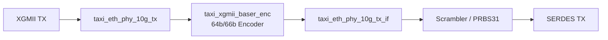
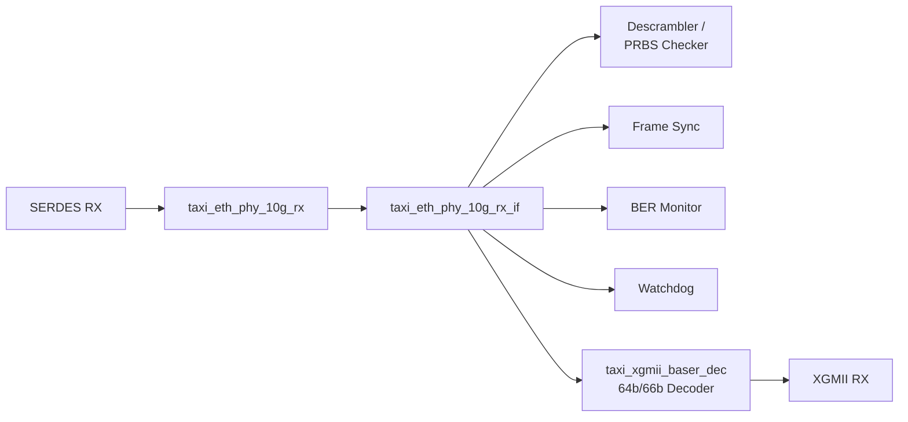

# DUT TAXI_ETH_PHY_10G


# Objetivo

El objetivo de este proyecto es verificar una implementación Ethernet PHY desarrollada en SystemVerilog asegurando el correcto funcionamiento funcional y protocolar de acuerdo con IEEE 802.3.

La verificación contempla tanto condiciones normales de operación como casos límite, escenarios de error y situaciones de recuperación.

---

# Estándar Aplicable

## IEEE 802.3

Cláusulas principales involucradas:

### Clause 46

Interfaz XGMII.

Validación de:

- caracteres de control
- START
- TERM
- secuencias válidas
- secuencias inválidas

### Clause 49

PCS 10GBASE-R.

Validación de:

- 64b66b Encoding
- 64b66b Decoding
- Sync Headers
- Block Lock
- Scrambler
- BER Monitoring
- PRBS31
- Recovery Mechanisms

---

# Función General del DUT

El DUT implementa una PHY Ethernet que traduce tráfico XGMII hacia una interfaz SERDES utilizando codificación 64b/66b.

Durante recepción realiza:

- recuperación de sincronización
- adquisición de lock
- detección de errores
- reconstrucción de tráfico XGMII

---

# Estructura de archivos 

```
taxi_eth_phy_10g
    │
    ├─ taxi_eth_phy_10g_tx
    │   │
    │   ├─ taxi_xgmii_baser_enc
    │   │
    │   └─ taxi_eth_phy_10g_tx_if
    │        │
    │        └─ Scrambler / PRBS31
    │
    │                           
    │           [SERDES TX]
    │
    │            [CHANNEL]
    │
    │           [SERDES RX]    
    │
    │
    └─ taxi_eth_phy_10g_rx
        │
        ├─ taxi_eth_phy_10g_rx_if
        │    │
        │    ├─ Descrambler / Checker
        │    ├─ Frame Sync
        │    ├─ BER Monitor
        │    └─ Watchdog
        │
        └─ taxi_xgmii_baser_dec
```


# Diagrama taxi_eth_phy_10g_tx 



# Diagrama taxi_eth_phy_10g_rx 


---

# Arquitectura Principal

## Encoder

Responsabilidad:

- Conversión XGMII → 64b66b
- Generación de Sync Header
- Generación de Control Blocks

---

## Decoder

Responsabilidad:

- Conversión 64b66b → XGMII
- Reconstrucción de bloques de datos
- Reconstrucción de bloques de control

---

## Scrambler

Responsabilidad:

- Aleatorización de datos
- Cumplimiento de Clause 49

---

## Descrambler

Responsabilidad:

- Recuperación de datos originales

---

## Block Lock

Responsabilidad:

- Detección de Sync Headers válidos
- Adquisición de sincronización
- Recuperación tras errores

---

## BER Monitor

Responsabilidad:

- Monitoreo de errores persistentes
- Generación de señales High BER

---

## Gearbox

Responsabilidad:

- Adaptación de ancho de interfaz
- Sincronización entre dominios

---

## PRBS31

Responsabilidad:

- Generación de patrones de prueba
- Detección de errores
- Validación de enlace

---

# Interfaces Principales

## TX

### xgmii_txd

Datos XGMII transmitidos.

### xgmii_txc

Control XGMII transmitido.

---

## RX

### xgmii_rxd

Datos XGMII recibidos.

### xgmii_rxc

Control XGMII recibido.

---

## SERDES

### serdes_tx_data

Datos de salida hacia SERDES.

### serdes_rx_data

Datos de entrada desde SERDES.

### serdes_rx_hdr

Sync Header recibido.

### serdes_rx_hdr_valid

Validez del Sync Header.

---

---

# Riesgos de Verificación

## Críticos

### Block Lock 
Pérdida o adquisición incorrecta.

### Sync Header

Detección incorrecta de cabeceras.

### Decoder

Reconstrucción incorrecta de información.

### Encoder

Generación incorrecta de bloques.

---

## Importantes

### Scrambler

Alteración de secuencia.

### BER Monitor

Activación incorrecta de errores.

### Gearbox

Problemas de alineación.

### PRBS31

Desfase entre referencia y DUT.

---

# Objetivos de Cobertura

La estrategia de verificación busca cubrir:

- Reset
- Encoder
- Decoder
- Control Blocks
- Data Blocks
- Block Lock
- Loss of Lock
- Lock Recovery
- BER Monitoring
- PRBS31
- Scrambler
- Gearbox
- Width Adaptation
- Error Handling
- Recovery Mechanisms

---

# Criterios de Éxito

La verificación se considerará satisfactoria cuando:

- Todos los tests P0 finalicen en PASS.
- Todos los bloques principales tengan cobertura funcional.
- Exista trazabilidad IEEE → Feature → Test.
- No existan errores críticos abiertos.
- Los mecanismos de recuperación funcionen correctamente.
- La cobertura de funcionalidades principales alcance el objetivo definido.

---

# Artefactos de Verificación Implementados

## Test Plan

Describe todos los casos de prueba.

---

## Coverage Matrix

Relaciona funcionalidades con pruebas.

---

## IEEE Traceability Matrix

Relaciona requisitos IEEE con pruebas.

---