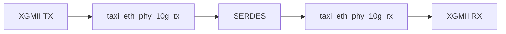
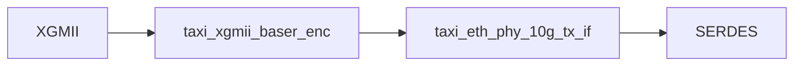
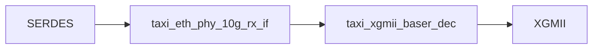

# Auditoría de taxi_eth_phy_10g

## Objetivo

Comprender la arquitectura interna de `taxi_eth_phy_10g`, identificar sus bloques funcionales, documentar el flujo de datos y relevar las señales utilizadas entre módulos para futuras tareas de validación y auditoría.

---

## Alcance

Módulo principal auditado:

- taxi_eth_phy_10g

Submódulos identificados:

- taxi_eth_phy_10g_tx
- taxi_eth_phy_10g_rx
- taxi_xgmii_baser_enc
- taxi_xgmii_baser_dec
- taxi_eth_phy_10g_tx_if
- taxi_eth_phy_10g_rx_if

---

## Estado Actual

### Entorno

- ✅ Repositorio configurado
- ✅ Entorno virtual operativo
- ✅ Cocotb funcionando
- ✅ Verilator funcionando
- ✅ Tests originales ejecutados correctamente

### Validación Inicial

```text
TESTS = 3
PASS  = 3
FAIL  = 0
```

---

## Arquitectura General



---

## Arquitectura TX



### taxi_xgmii_baser_enc

Responsabilidades identificadas:

```text
- Codificación XGMII → 64b/66b
- Generación de Sync Header
- Conversión de bloques de control
```

### taxi_eth_phy_10g_tx_if

Responsabilidades identificadas:

```text
- Scrambler
- PRBS31 Generator
- Bit Reversal
- SERDES Pipeline
- Gearbox Synchronization
```

---

## Arquitectura RX



### taxi_eth_phy_10g_rx_if

Responsabilidades identificadas:

```text
- Descrambler
- PRBS31 Checker
- Bit Reversal
- SERDES Pipeline
- Frame Synchronization
- BER Monitoring
- Watchdog
```

### taxi_xgmii_baser_dec

Responsabilidades identificadas:

```text
- Decodificación 64b/66b
- Reconstrucción de interfaz XGMII
```

---

## Submódulos RX Identificados

Durante el análisis de `taxi_eth_phy_10g_rx_if` fueron identificados los siguientes bloques internos:

```text
taxi_eth_phy_10g_rx_frame_sync
taxi_eth_phy_10g_rx_ber_mon
taxi_eth_phy_10g_rx_watchdog
```

Estos bloques serán analizados en detalle para comprender la lógica de validación y monitoreo del receptor.

---

## Estado del Receptor

Las siguientes señales fueron identificadas como indicadores principales del estado operativo del enlace:

```text
rx_error_count
rx_bad_block
rx_sequence_error
rx_block_lock
rx_high_ber
rx_status
```

### Descripción preliminar

| Señal | Función |
|---------|---------|
| rx_error_count | Contador de errores detectados |
| rx_bad_block | Bloque inválido detectado |
| rx_sequence_error | Error de secuencia detectado |
| rx_block_lock | Indica alineación de bloques 64b/66b |
| rx_high_ber | Indica alta tasa de errores |
| rx_status | Estado general del receptor |

---

## Matriz de Señales Confirmadas

### Camino TX

| Señal | Origen | Destino |
|---------|---------|---------|
| xgmii_txd | Exterior | taxi_xgmii_baser_enc |
| xgmii_txc | Exterior | taxi_xgmii_baser_enc |
| encoded_tx_data | taxi_xgmii_baser_enc | taxi_eth_phy_10g_tx_if |
| encoded_tx_data_valid | taxi_xgmii_baser_enc | taxi_eth_phy_10g_tx_if |
| encoded_tx_hdr | taxi_xgmii_baser_enc | taxi_eth_phy_10g_tx_if |
| encoded_tx_hdr_valid | taxi_xgmii_baser_enc | taxi_eth_phy_10g_tx_if |
| serdes_tx_data | taxi_eth_phy_10g_tx_if | Exterior |
| serdes_tx_data_valid | taxi_eth_phy_10g_tx_if | Exterior |
| serdes_tx_hdr | taxi_eth_phy_10g_tx_if | Exterior |
| serdes_tx_hdr_valid | taxi_eth_phy_10g_tx_if | Exterior |

### Camino RX

| Señal | Origen | Destino |
|---------|---------|---------|
| serdes_rx_data | Exterior | taxi_eth_phy_10g_rx_if |
| serdes_rx_data_valid | Exterior | taxi_eth_phy_10g_rx_if |
| serdes_rx_hdr | Exterior | taxi_eth_phy_10g_rx_if |
| serdes_rx_hdr_valid | Exterior | taxi_eth_phy_10g_rx_if |
| encoded_rx_data | taxi_eth_phy_10g_rx_if | taxi_xgmii_baser_dec |
| encoded_rx_data_valid | taxi_eth_phy_10g_rx_if | taxi_xgmii_baser_dec |
| encoded_rx_hdr | taxi_eth_phy_10g_rx_if | taxi_xgmii_baser_dec |
| encoded_rx_hdr_valid | taxi_eth_phy_10g_rx_if | taxi_xgmii_baser_dec |
| xgmii_rxd | taxi_xgmii_baser_dec | Exterior |
| xgmii_rxc | taxi_xgmii_baser_dec | Exterior |

---

## Próximos Pasos

1. Analizar la implementación de:
   - taxi_eth_phy_10g_rx_frame_sync
   - taxi_eth_phy_10g_rx_ber_mon
   - taxi_eth_phy_10g_rx_watchdog

2. Completar la matriz de señales de estado del receptor.

3. Determinar los criterios utilizados para:
   - Block Lock
   - Loss of Lock
   - High BER
   - RX Status

4. Definir los primeros casos de prueba orientados a la validación del receptor.

