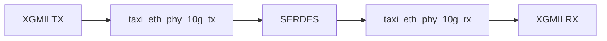
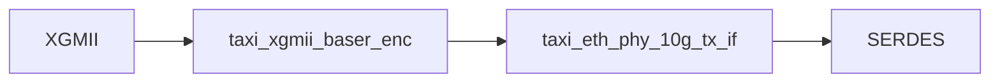
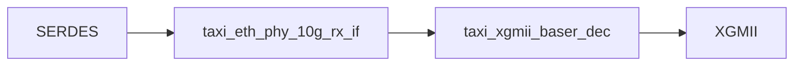

# Auditoría de taxi_eth_phy_10g

## Objetivo

Comprender la arquitectura interna de `taxi_eth_phy_10g`, identificar sus bloques funcionales, documentar el flujo de datos y relevar las señales utilizadas entre módulos para futuras tareas de validación y auditoría.

---

## Alcance

Módulo principal auditado:

- taxi_eth_phy_10g

Submódulos identificados:

- taxi_eth_phy_10g_tx
- taxi_eth_phy_10g_rx
- taxi_xgmii_baser_enc
- taxi_xgmii_baser_dec
- taxi_eth_phy_10g_tx_if
- taxi_eth_phy_10g_rx_if

---

## Estado Actual

### Entorno

- ✅ Repositorio configurado
- ✅ Entorno virtual operativo
- ✅ Cocotb funcionando
- ✅ Verilator funcionando
- ✅ Tests originales ejecutados correctamente

### Validación Inicial

```text
TESTS = 3
PASS  = 3
FAIL  = 0
```

---

## Arquitectura General



---

## Arquitectura TX



### taxi_xgmii_baser_enc

Responsabilidades identificadas:

```text
- Codificación XGMII → 64b/66b
- Generación de Sync Header
- Conversión de bloques de control
```

### taxi_eth_phy_10g_tx_if

Responsabilidades identificadas:

```text
- Scrambler
- PRBS31 Generator
- Bit Reversal
- SERDES Pipeline
- Gearbox Synchronization
```

---

## Arquitectura RX



### taxi_eth_phy_10g_rx_if

Responsabilidades identificadas:

```text
- Descrambler
- PRBS31 Checker
- Bit Reversal
- SERDES Pipeline
- Frame Synchronization
- BER Monitoring
- Watchdog
```

### taxi_xgmii_baser_dec

Responsabilidades identificadas:

```text
- Decodificación 64b/66b
- Reconstrucción de interfaz XGMII
```

---

## Submódulos RX Identificados

Durante el análisis de `taxi_eth_phy_10g_rx_if` fueron identificados los siguientes bloques internos:

```text
taxi_eth_phy_10g_rx_frame_sync
taxi_eth_phy_10g_rx_ber_mon
taxi_eth_phy_10g_rx_watchdog
```

Estos bloques serán analizados en detalle para comprender la lógica de validación y monitoreo del receptor.

---

## Estado del Receptor

Las siguientes señales fueron identificadas como indicadores principales del estado operativo del enlace:

```text
rx_error_count
rx_bad_block
rx_sequence_error
rx_block_lock
rx_high_ber
rx_status
```

### Descripción preliminar

| Señal | Función |
|:---------:|:---------:|
| rx_error_count | Contador de errores detectados |
| rx_bad_block | Bloque inválido detectado |
| rx_sequence_error | Error de secuencia detectado |
| rx_block_lock | Indica alineación de bloques 64b/66b |
| rx_high_ber | Indica alta tasa de errores |
| rx_status | Estado general del receptor |

---

## Matriz de Señales Confirmadas

### Camino TX

| Señal | Origen | Destino |
|---------|---------|---------|
| xgmii_txd | Exterior | taxi_xgmii_baser_enc |
| xgmii_txc | Exterior | taxi_xgmii_baser_enc |
| encoded_tx_data | taxi_xgmii_baser_enc | taxi_eth_phy_10g_tx_if |
| encoded_tx_data_valid | taxi_xgmii_baser_enc | taxi_eth_phy_10g_tx_if |
| encoded_tx_hdr | taxi_xgmii_baser_enc | taxi_eth_phy_10g_tx_if |
| encoded_tx_hdr_valid | taxi_xgmii_baser_enc | taxi_eth_phy_10g_tx_if |
| serdes_tx_data | taxi_eth_phy_10g_tx_if | Exterior |
| serdes_tx_data_valid | taxi_eth_phy_10g_tx_if | Exterior |
| serdes_tx_hdr | taxi_eth_phy_10g_tx_if | Exterior |
| serdes_tx_hdr_valid | taxi_eth_phy_10g_tx_if | Exterior |

### Camino RX

| Señal | Origen | Destino |
|---------|---------|---------|
| serdes_rx_data | Exterior | taxi_eth_phy_10g_rx_if |
| serdes_rx_data_valid | Exterior | taxi_eth_phy_10g_rx_if |
| serdes_rx_hdr | Exterior | taxi_eth_phy_10g_rx_if |
| serdes_rx_hdr_valid | Exterior | taxi_eth_phy_10g_rx_if |
| encoded_rx_data | taxi_eth_phy_10g_rx_if | taxi_xgmii_baser_dec |
| encoded_rx_data_valid | taxi_eth_phy_10g_rx_if | taxi_xgmii_baser_dec |
| encoded_rx_hdr | taxi_eth_phy_10g_rx_if | taxi_xgmii_baser_dec |
| encoded_rx_hdr_valid | taxi_eth_phy_10g_rx_if | taxi_xgmii_baser_dec |
| xgmii_rxd | taxi_xgmii_baser_dec | Exterior |
| xgmii_rxc | taxi_xgmii_baser_dec | Exterior |

---

## Estrategia de Validación

El objetivo de la auditoría no es únicamente comprender la arquitectura del PHY, sino también verificar su correcto funcionamiento y su conformidad con IEEE 802.3 Clause 49 mediante pruebas dirigidas y agentes reutilizables.

La estrategia adoptada consiste en:

1. Identificar las interfaces de cada bloque.
2. Definir los casos de prueba necesarios.
3. Implementar agentes reutilizables.
4. Ejecutar los tests y registrar resultados.
5. Analizar posibles desviaciones respecto al estándar.

---

## Categorías de Pruebas

### Integridad Funcional

Estas pruebas verifican el correcto transporte de información entre la interfaz XGMII de transmisión y la interfaz XGMII de recepción.

#### TEST-F01 - Loopback Básico

Objetivo:

```text
Verificar transmisión extremo a extremo.
```

Entradas:

```text
xgmii_txd
xgmii_txc
```

Salidas verificadas:

```text
xgmii_rxd
xgmii_rxc
```

Resultado esperado:

```text
TX == RX
```

---

#### TEST-F02 - Frame Mínima

Objetivo:

```text
Validar el procesamiento de una trama Ethernet mínima.
```

Resultado esperado:

```text
Recepción correcta sin errores.
```

---

#### TEST-F03 - Frame Máxima

Objetivo:

```text
Validar el procesamiento de una trama Ethernet máxima.
```

Resultado esperado:

```text
Recepción correcta sin errores.
```

---

### Block Lock

Estas pruebas validan los mecanismos de sincronización del receptor.

#### TEST-BL01 - Adquisición de Lock

Señal monitoreada:

```text
rx_block_lock
```

Resultado esperado:

```text
0 → 1
```

---

#### TEST-BL02 - Pérdida de Lock

Acción:

```text
Introducir errores o headers inválidos.
```

Resultado esperado:

```text
1 → 0
```

---

#### TEST-BL03 - Recuperación de Lock

Acción:

```text
Restaurar el flujo correcto.
```

Resultado esperado:

```text
0 → 1
```

---

### BER Monitoring

Estas pruebas verifican la detección y contabilización de errores.

#### TEST-BER01 - Canal Limpio

Señal monitoreada:

```text
rx_high_ber
```

Resultado esperado:

```text
rx_high_ber = 0
```

---

#### TEST-BER02 - High BER

Acción:

```text
Inyectar errores de forma controlada.
```

Resultado esperado:

```text
rx_high_ber = 1
```

---

#### TEST-BER03 - Error Counter

Señal monitoreada:

```text
rx_error_count
```

Resultado esperado:

```text
Incremento consistente con los errores inyectados.
```

---

### Cumplimiento IEEE 802.3 Clause 49

Estas pruebas buscan verificar conformidad con el estándar.

#### TEST-STD01 - Sync Headers

Validar que únicamente aparezcan los headers:

```text
01
10
```

---

#### TEST-STD02 - Start Block

Verificar la codificación del bloque START.

Bloque analizado:

```text
taxi_xgmii_baser_enc
```

---

#### TEST-STD03 - Terminate Block

Verificar la codificación del bloque TERM.

Bloque analizado:

```text
taxi_xgmii_baser_enc
```

---

#### TEST-STD04 - Decodificación

Verificar la correcta reconstrucción de la interfaz XGMII.

Bloque analizado:

```text
taxi_xgmii_baser_dec
```

---

#### TEST-STD05 - Block Lock

Verificar que el mecanismo de adquisición y pérdida de lock siga los criterios definidos por el estándar.

Bloque analizado:

```text
taxi_eth_phy_10g_rx_frame_sync
```

---

#### TEST-STD06 - High BER

Verificar que la detección de alta tasa de errores siga los criterios definidos por el estándar.

Bloque analizado:

```text
taxi_eth_phy_10g_rx_ber_mon
```

---

## Agentes de Validación

Los agentes constituyen componentes reutilizables destinados a estimular y monitorear las interfaces del PHY.

### XGMII Agent

Responsabilidades:

```text
- Generar tráfico XGMII.
- Construir tramas de prueba.
- Inyectar patrones específicos.
```

Interfaces:

```text
xgmii_txd
xgmii_txc
```

---

### XGMII Monitor

Responsabilidades:

```text
- Capturar tráfico recibido.
- Reconstruir tramas.
- Comparar resultados esperados.
```

Interfaces:

```text
xgmii_rxd
xgmii_rxc
```

---

### SERDES Agent

Responsabilidades:

```text
- Estimular la interfaz SERDES.
- Inyectar errores controlados.
- Generar condiciones de pérdida de lock.
```

Interfaces:

```text
serdes_rx_data
serdes_rx_hdr
```

---

### RX Status Monitor

Responsabilidades:

```text
- Monitorear el estado del receptor.
- Capturar eventos de lock y unlock.
- Registrar errores.
```

Señales observadas:

```text
rx_error_count
rx_bad_block
rx_sequence_error
rx_block_lock
rx_high_ber
rx_status
```

---

## Próxima Etapa

Una vez completado el análisis arquitectónico se procederá a:

1. Implementar los agentes definidos.
2. Construir los primeros testbench de auditoría.
3. Ejecutar pruebas funcionales.
4. Ejecutar pruebas de conformidad IEEE.
5. Documentar los hallazgos obtenidos.

