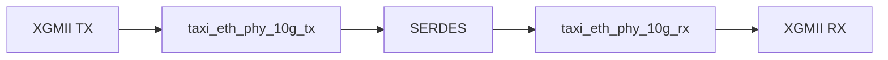
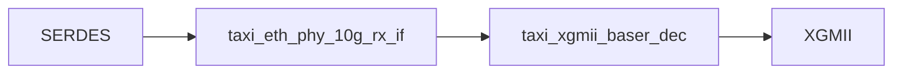

# TEST PLAN

## Objetivo

Comprender la arquitectura interna de `taxi_eth_phy_10g`, identificar sus bloques funcionales, documentar el flujo de datos y relevar las señales utilizadas entre módulos para futuras tareas de validación y auditoría.

---

## Alcance

Módulo principal auditado:

- taxi_eth_phy_10g

Submódulos identificados:

- taxi_eth_phy_10g_tx
- taxi_eth_phy_10g_rx
- taxi_xgmii_baser_enc
- taxi_xgmii_baser_dec
- taxi_eth_phy_10g_tx_if
- taxi_eth_phy_10g_rx_if

---

## Estado Actual

### Entorno

- ✅ Repositorio configurado
- ✅ Entorno virtual operativo
- ✅ Cocotb funcionando
- ✅ Verilator funcionando
- ✅ Tests originales ejecutados correctamente

### Validación Inicial

```text
TESTS = 3
PASS  = 3
FAIL  = 0
```

---

## Arquitectura General



---

## Arquitectura TX


### taxi_xgmii_baser_enc

Responsabilidades identificadas:

```text
- Codificación XGMII → 64b/66b
- Generación de Sync Header
- Conversión de bloques de control
```

### taxi_eth_phy_10g_tx_if

Responsabilidades identificadas:

```text
- Scrambler
- PRBS31 Generator
- Bit Reversal
- SERDES Pipeline
- Gearbox Synchronization
```

---

## Arquitectura RX



### taxi_eth_phy_10g_rx_if

Responsabilidades identificadas:

```text
- Descrambler
- PRBS31 Checker
- Bit Reversal
- SERDES Pipeline
- Frame Synchronization
- BER Monitoring
- Watchdog
```

### taxi_xgmii_baser_dec

Responsabilidades identificadas:

```text
- Decodificación 64b/66b
- Reconstrucción de interfaz XGMII
```

---

## Submódulos RX Identificados

Durante el análisis de `taxi_eth_phy_10g_rx_if` fueron identificados los siguientes bloques internos:

```text
taxi_eth_phy_10g_rx_frame_sync
taxi_eth_phy_10g_rx_ber_mon
taxi_eth_phy_10g_rx_watchdog
```

Estos bloques serán analizados en detalle para comprender la lógica de validación y monitoreo del receptor.

---

## Estado del Receptor

Las siguientes señales fueron identificadas como indicadores principales del estado operativo del enlace:

```text
rx_error_count
rx_bad_block
rx_sequence_error
rx_block_lock
rx_high_ber
rx_status
```

### Descripción preliminar

| Señal | Función |
|:---------:|:---------:|
| rx_error_count | Contador de errores detectados |
| rx_bad_block | Bloque inválido detectado |
| rx_sequence_error | Error de secuencia detectado |
| rx_block_lock | Indica alineación de bloques 64b/66b |
| rx_high_ber | Indica alta tasa de errores |
| rx_status | Estado general del receptor |

---

## Matriz de Señales Confirmadas

### Camino TX

| Señal | Origen | Destino |
|---------|---------|---------|
| xgmii_txd | Exterior | taxi_xgmii_baser_enc |
| xgmii_txc | Exterior | taxi_xgmii_baser_enc |
| encoded_tx_data | taxi_xgmii_baser_enc | taxi_eth_phy_10g_tx_if |
| encoded_tx_data_valid | taxi_xgmii_baser_enc | taxi_eth_phy_10g_tx_if |
| encoded_tx_hdr | taxi_xgmii_baser_enc | taxi_eth_phy_10g_tx_if |
| encoded_tx_hdr_valid | taxi_xgmii_baser_enc | taxi_eth_phy_10g_tx_if |
| serdes_tx_data | taxi_eth_phy_10g_tx_if | Exterior |
| serdes_tx_data_valid | taxi_eth_phy_10g_tx_if | Exterior |
| serdes_tx_hdr | taxi_eth_phy_10g_tx_if | Exterior |
| serdes_tx_hdr_valid | taxi_eth_phy_10g_tx_if | Exterior |

### Camino RX

| Señal | Origen | Destino |
|---------|---------|---------|
| serdes_rx_data | Exterior | taxi_eth_phy_10g_rx_if |
| serdes_rx_data_valid | Exterior | taxi_eth_phy_10g_rx_if |
| serdes_rx_hdr | Exterior | taxi_eth_phy_10g_rx_if |
| serdes_rx_hdr_valid | Exterior | taxi_eth_phy_10g_rx_if |
| encoded_rx_data | taxi_eth_phy_10g_rx_if | taxi_xgmii_baser_dec |
| encoded_rx_data_valid | taxi_eth_phy_10g_rx_if | taxi_xgmii_baser_dec |
| encoded_rx_hdr | taxi_eth_phy_10g_rx_if | taxi_xgmii_baser_dec |
| encoded_rx_hdr_valid | taxi_eth_phy_10g_rx_if | taxi_xgmii_baser_dec |
| xgmii_rxd | taxi_xgmii_baser_dec | Exterior |
| xgmii_rxc | taxi_xgmii_baser_dec | Exterior |

---
## Estrategia de Verificación

La auditoría se implementará mediante componentes de verificación desarrollados en SystemVerilog.

Estos componentes tendrán como objetivo estimular interfaces, monitorear señales internas y verificar el cumplimiento funcional de los diferentes bloques que componen el PHY.

La estrategia adoptada consiste en:

1. Comprender la arquitectura del bloque.
2. Identificar las señales de entrada y salida.
3. Definir los casos de prueba.
4. Implementar agentes reutilizables.
5. Ejecutar las pruebas.
6. Analizar resultados y posibles desviaciones respecto al estándar.

---

## Agentes de Verificación

Los agentes son componentes reutilizables desarrollados en SystemVerilog que permiten generar estímulos, monitorear interfaces y observar el estado interno del PHY.

### XGMII Driver

Responsabilidades:

```text
- Generar tráfico XGMII.
- Generar secuencias START.
- Generar secuencias TERM.
- Generar secuencias IDLE.
- Generar tramas Ethernet de prueba.
```

Interfaces utilizadas:

```text
xgmii_txd
xgmii_txc
```

---

### XGMII Monitor

Responsabilidades:

```text
- Capturar tráfico recibido.
- Reconstruir tramas recibidas.
- Comparar tráfico transmitido y recibido.
```

Interfaces utilizadas:

```text
xgmii_rxd
xgmii_rxc
```

---

### SERDES Driver

Responsabilidades:

```text
- Generar tráfico directamente sobre la interfaz SERDES.
- Generar bloques válidos 64b/66b.
- Estimular el receptor de forma controlada.
```

Interfaces utilizadas:

```text
serdes_rx_data
serdes_rx_hdr
serdes_rx_data_valid
serdes_rx_hdr_valid
```

---

### SERDES Fault Injector

Responsabilidades:

```text
- Introducir errores de bits.
- Introducir headers inválidos.
- Generar pérdida de sincronización.
- Generar condiciones de error controladas.
- Generar escenarios de High BER.
```

Interfaces utilizadas:

```text
serdes_rx_data
serdes_rx_hdr
```

---

### RX Status Monitor

Responsabilidades:

```text
- Monitorear el estado operativo del receptor.
- Registrar eventos de adquisición de lock.
- Registrar eventos de pérdida de lock.
- Registrar eventos de High BER.
- Registrar errores detectados por el receptor.
```

Señales observadas:

```text
rx_error_count
rx_bad_block
rx_sequence_error
rx_block_lock
rx_high_ber
rx_status
```

---

## Plan de Pruebas

### Categoría A - Integridad Funcional

Objetivo:

```text
Verificar la transmisión correcta extremo a extremo.
```

#### TEST-A1 - Loopback Básico

Agentes utilizados:

```text
XGMII Driver
XGMII Monitor
```

Verificación:

```text
TX == RX
```

---

#### TEST-A2 - Trama Ethernet Mínima

Agentes utilizados:

```text
XGMII Driver
XGMII Monitor
```

Resultado esperado:

```text
Recepción correcta sin errores.
```

---

#### TEST-A3 - Trama Ethernet Máxima

Agentes utilizados:

```text
XGMII Driver
XGMII Monitor
```

Resultado esperado:

```text
Recepción correcta sin errores.
```

---

### Categoría B - Block Lock

Objetivo:

```text
Validar los mecanismos de sincronización del receptor.
```

#### TEST-B1 - Adquisición de Lock

Agentes utilizados:

```text
SERDES Driver
RX Status Monitor
```

Señal observada:

```text
rx_block_lock
```

Resultado esperado:

```text
0 → 1
```

---

#### TEST-B2 - Pérdida de Lock

Agentes utilizados:

```text
SERDES Fault Injector
RX Status Monitor
```

Resultado esperado:

```text
1 → 0
```

---

#### TEST-B3 - Recuperación de Lock

Agentes utilizados:

```text
SERDES Driver
SERDES Fault Injector
RX Status Monitor
```

Resultado esperado:

```text
0 → 1
```

---

### Categoría C - BER Monitoring

Objetivo:

```text
Validar la detección y contabilización de errores.
```

#### TEST-BER1 - Canal Limpio

Agentes utilizados:

```text
SERDES Driver
RX Status Monitor
```

Señal observada:

```text
rx_high_ber
```

Resultado esperado:

```text
rx_high_ber = 0
```

---

#### TEST-BER2 - High BER

Agentes utilizados:

```text
SERDES Fault Injector
RX Status Monitor
```

Resultado esperado:

```text
rx_high_ber = 1
```

---

#### TEST-BER3 - Error Counter

Agentes utilizados:

```text
SERDES Fault Injector
RX Status Monitor
```

Señal observada:

```text
rx_error_count
```

Resultado esperado:

```text
Incremento consistente con la cantidad de errores introducidos.
```

---

### Categoría D - Cumplimiento IEEE 802.3 Clause 49

Objetivo:

```text
Verificar conformidad funcional con los requisitos del estándar.
```

#### TEST-STD1 - Sync Header

Bloque analizado:

```text
taxi_xgmii_baser_enc
```

Verificación:

```text
Validar generación de headers 01 y 10.
```

---

#### TEST-STD2 - Start Block

Bloque analizado:

```text
taxi_xgmii_baser_enc
```

Verificación:

```text
Validar codificación de bloques START.
```

---

#### TEST-STD3 - Terminate Block

Bloque analizado:

```text
taxi_xgmii_baser_enc
```

Verificación:

```text
Validar codificación de bloques TERM.
```

---

#### TEST-STD4 - Decoder

Bloque analizado:

```text
taxi_xgmii_baser_dec
```

Verificación:

```text
Validar reconstrucción correcta de la interfaz XGMII.
```

---

#### TEST-STD5 - Block Lock

Bloque analizado:

```text
taxi_eth_phy_10g_rx_frame_sync
```

Verificación:

```text
Validar criterios de adquisición y pérdida de lock.
```

---

#### TEST-STD6 - High BER

Bloque analizado:

```text
taxi_eth_phy_10g_rx_ber_mon
```

Verificación:

```text
Validar criterios de detección de alta tasa de errores.
```

---

## Estructura de Trabajo

```text
rodri/
│
├── README.md
│
├── agents/
│   ├── xgmii_driver.sv
│   ├── xgmii_monitor.sv
│   ├── serdes_driver.sv
│   ├── serdes_fault_injector.sv
│   └── rx_status_monitor.sv
│
└── tests/
    ├── test_loopback_basic.sv
    ├── test_block_lock.sv
    ├── test_loss_of_lock.sv
    ├── test_lock_recovery.sv
    ├── test_high_ber.sv
    └── test_ieee_clause49.sv
```

